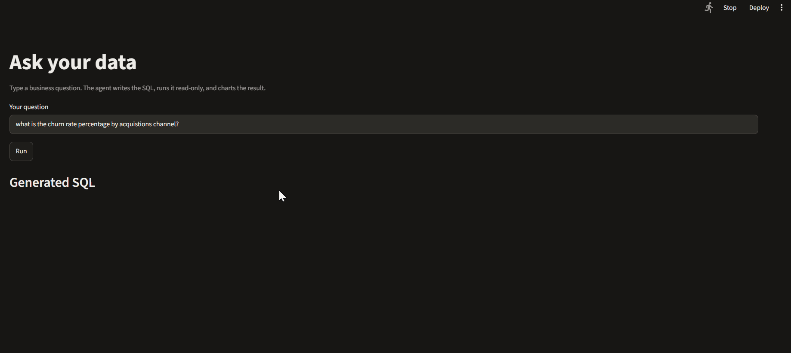

# Natural-Language-to-SQL Analytics Agent

Ask a business question in plain English. The app writes the SQL, runs it read-only on a MySQL database, and shows the query, the result table and a chart.

> *"Which plan has the highest churn rate?"* → SQL → table → bar chart, in a few seconds.



## Why I built it

My earlier project, the AI-Powered MRR Insight Generator, goes from numbers to text. This one goes the other way, from a question to a query. The part I cared about most was not the demo but the proof: how often is the generated SQL actually right, and what happens when it is not.

## How it works

```
Question → Prompt (schema + rules) → Gemini → SQL
        → Guard → Read-only MySQL → DataFrame
        → Table + auto chart + SQL shown (Streamlit)
```

| File | Job |
|---|---|
| `app.py` | Streamlit UI, one automatic retry if MySQL rejects the SQL |
| `schema.py` | Reads tables, columns, keys and sample rows from `information_schema` |
| `llm.py` | Prompt rules + Gemini call (temperature 0) |
| `guard.py` | SQL safety checks |
| `db.py` | Read-only connection with a 5-second query timeout |
| `charts.py` | Picks a line or bar chart from the shape of the result |
| `questions.csv`, `heldout.csv` | Test questions with hand-written gold SQL |
| `run_eval.py`, `rescore.py` | Runs the test sets and scores them |

## Safety

The generated SQL is always displayed, and only a single SELECT can run. Four layers:

1. **Read-only MySQL user.** The account has `SELECT` and nothing else, so even a bug in my code cannot change data.
2. **Parser-based guard.** `sqlglot` parses the query and rejects anything that is not one SELECT or UNION, any write or DDL statement, stacked statements, and functions like `SLEEP` and `LOAD_FILE`.
3. **Row limit and timeout.** A `LIMIT 500` is added when missing, and queries stop after 5 seconds.
4. **Prompt rule.** The model is told to return SELECT only and to answer `UNANSWERABLE` when the schema cannot answer the question.

In the 5 write-style prompts I tested ("Delete all customers", "Drop the payments table", a prompt-injection attempt, and others), the model refused every time. The guard was tested separately on `DROP`, `DELETE`, `UPDATE` and stacked statements, and blocked all of them.

## How accuracy is measured

I wrote 30 questions (10 easy, 12 medium, 8 hard) against the database, each with a gold SQL query. A question passes when the generated query returns the same values as the gold query. Row order, column order and extra columns are ignored, because two different queries can both be correct. SQL text is never compared.

| Run | Result |
|---|---|
| First run, strict scoring | 26/30 (87%) |
| After fixing the scoring and one prompt rule | 30/30 |
| Held-out set of 10 new questions | 10/10 |

### What the 4 first-run failures were

| Question | Cause | Fix |
|---|---|---|
| Which channel brings the most customers? | Model added a count column next to the channel | Scoring was too strict |
| Which cohort has the best 6-month retention? | Model added the retention value | Scoring was too strict |
| Signups per month in 2025 | Model's month labels were `2025-01-01`, my gold used `2025-01` | Gold changed to the database's own label format |
| Which region has the highest *share* of Enterprise customers? | Model counted Enterprise customers per region instead of dividing by all customers in the region | **Real model error.** Added a prompt rule for share / rate / ratio questions |

Three of the four were scoring problems and one was a real model mistake in a ratio calculation.

## Limitations

- The 30 questions and their gold SQL were written by me, and the scoring rules and one prompt rule were adjusted after seeing the first run. The 30/30 is a development score. The held-out set of 10 was written afterwards and not tuned against, but it is small and mostly simple patterns, so it is a sanity check and not a benchmark.
- Some questions are ambiguous. "Active customers" is counted from `subscriptions.status = 'active'`, and the model has to guess the same definition.
- The whole schema goes into the prompt, which works for 13 tables but would not scale to hundreds.
- No conversation memory: each question is answered on its own.
- The data is a synthetic SaaS subscription dataset, not production data.

## Run it

```bash
pip install streamlit google-genai sqlglot pymysql plotly python-dotenv sqlalchemy pandas
```

Create a read-only MySQL user:

```sql
CREATE USER 'nl2sql_ro'@'localhost' IDENTIFIED BY 'your_password';
GRANT SELECT ON saas_churn_analytics.* TO 'nl2sql_ro'@'localhost';
```

Create a `.env` file (never commit it):

```
GEMINI_API_KEY=your_key
GEMINI_MODEL=gemini-3.5-flash-lite
DB_USER=nl2sql_ro
DB_PASS=your_password
DB_HOST=localhost
DB_NAME=saas_churn_analytics
```

```bash
streamlit run app.py          # the app
python run_eval.py            # score questions.csv
python rescore.py             # re-score saved SQL without calling Gemini
```

To run the held-out set, set `QFILE=heldout.csv` and `RFILE=results_heldout.csv` first.

## Stack

Python, Streamlit, Gemini API, MySQL, SQLAlchemy, sqlglot, pandas, Plotly.
